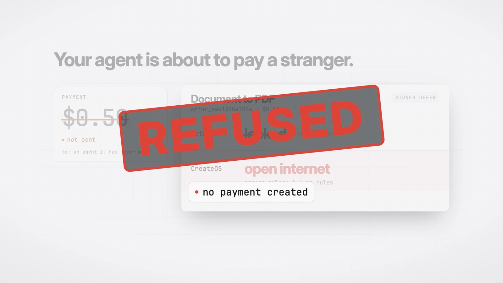

# Polygraph

The lie detector for AI agents.

**Your agent checks before it pays.** Polygraph checks a seller's signed claims against CreateOS's own records, then pays through Stripe.



AI agents now pay for tools on their own, one HTTP request at a time. They have no good way to tell whether the service they are paying is the one it claims to be. Polygraph is a working answer for one kind of service: an open-source tool run in a sandbox. A seller agent packages the tool and offers it for sale. A buyer agent checks every claim the seller makes against CreateOS's own records before any money moves, refuses offers that don't match, pays with Stripe, and then runs its job inside the exact sandbox it checked.

**Live:** https://production-polygraph.tyzo.nodeops.app (gateway and live console) · **Video:** [youtu.be/FiD6RquSaj0](https://youtu.be/FiD6RquSaj0) · **Post:** [on X](https://x.com/heykinnu/status/2111617787328401514) · **Leaderboard:** [projects.dev/vote/polygraph](https://projects.dev/vote/polygraph) · **Evidence:** [docs/runs](docs/runs/README.md) · **For agents:** [/llms.txt](https://production-polygraph.tyzo.nodeops.app/llms.txt), [/openapi.json](https://production-polygraph.tyzo.nodeops.app/openapi.json)

**6 of 6 dishonest offers refused on the live gateway · 5 before any payment existed · the seller agent's tool passes 17 of 17 hidden tests, plain LibreOffice 14 of 17**

**Who needs this.** Any agent platform or agent wallet that lets agents pay for tools needs proof that the tool it paid for is the one it checked. Polygraph is that check, sitting between the buyer and the payment. It could charge a small fee per verified purchase, or a marketplace could run it on every listing. The document converter here is the first listing, not the product.

**Why not just trust the marketplace?** Other marketplaces verify a tool once and ask buyers to trust the marketplace. In Polygraph the buyer trusts neither the seller nor the gateway: it asks CreateOS directly, with a short-lived token scoped to one sandbox, whether that sandbox is paused, forked from the signed parent and locked down on the network, and it checks again after paying. A gateway that says "verified" would be grading itself.

## Try it in 60 seconds

1. Open the [live console](https://production-polygraph.tyzo.nodeops.app/?console=1) and press **Replay** to watch a recorded seller and buyer run.
2. See what an agent sees. The test foils are listed on purpose, so you can watch a buyer refuse them:
   ```bash
   curl -s https://production-polygraph.tyzo.nodeops.app/offers | jq '.[].manifest | {offerId, name, egress, parentSandboxId}'
   ```
3. With your own keys (see [Run it](#run-it)), run the buyer agent against the live gateway:
   ```bash
   npm run buyer -- --file apps/buyer/fixtures/contract.docx --gateway https://production-polygraph.tyzo.nodeops.app --trust-seller
   ```

In three lines:
- A seller agent writes a document converter, tests it in a CreateOS sandbox, fixes what fails, locks the network and signs an offer.
- A buyer agent asks CreateOS itself, not the seller, whether that sandbox really is what the offer says. It pays $0.50 through Stripe only if it is.
- Against the live gateway, **6 of 6 dishonest offers were refused**. Five were stopped before any payment was created. The sixth was paid, caught by the buyer's own file hashing, and refunded automatically.

**Production status.** CreateOS deploys stopped starting late in the event, so the live gateway runs commit `f53c676e` from 02:57 IST. Everything in "Latest verified run" happened on that build. Two later features are on `master` only: the tamper-it-yourself buttons on the dashboard, and the 45 second deadline that answers a slow worker start with a refund and a warm retry.

Built during the CreateOS x Stripe Projects hackathon on October 17, 2026 (PT). The first commit is at 01:18 IST on October 18, 48 minutes after the event opened.

## The problem

- Hosted agent runtimes can't install heavy software. Gemini's code execution docs say "You can't install your own libraries," with a 30 second limit, and other hosted runtimes block package installs or internet access during a run. None ship LibreOffice, so a plain request like "turn this contract into a PDF" fails inside the agent.
- Agents already pay per call. Payments over x402 on Base grew from about 1,500 transactions in mid 2025 to more than 138 million by Q3 2026, and 87% were under 10 cents (Fortune, citing Chainalysis, Oct 2026).
- Paying is easy; trusting is not. A probe of 20,338 paid agent endpoints found 161 priced as wallet-draining traps and services that take payment and return nothing (dev.to/afx, April 2026).

## How it works

```
seller agent                     gateway (CreateOS)                    buyer agent
------------                     ------------------                    -----------
writes convert.py + tests  ->
runs them in a sandbox,
fixes what fails
locks egress, pauses the
sandbox, signs an offer    ->    GET /offers, /llms.txt,      <-       discovers offers
                                 /openapi.json
                                 GET /offers/:id/inspect      <-       gets a short-lived token
                                 (token for the paused parent)         for the paused parent
                                                                       asks CreateOS directly:
                                                                       is it paused? does its
                                                                       real egress match the
                                                                       signed claim?  no -> refuse
                                 POST /offers/:id/buy         <-       pays $0.50 (Stripe MPP,
                                 402 -> pay -> fork a worker            shared payment token)
                                 from the parent, reseed it,
                                 token scoped to that worker,
                                 proof ids on the PaymentIntent
                                                                       asks CreateOS again:
                                                                       forked_from == signed parent?
                                                                       egress == claim?
                                                                       tool digest == signed digest?
                                                                       no -> withhold the file, refund
                                                                       uploads the document, runs the
                                                                       converter itself in that worker,
                                                                       downloads the PDF, writes a receipt
                                 POST /purchases/:id/done     <-       worker destroyed
```

Four acts, the same ones the dashboard shows live:

1. Create. The seller agent gets a one-line spec and an interface contract (archival PDF/A-2b output, title metadata, every spreadsheet sheet, fixed exit codes), writes the converter and its own tests, runs them in a CreateOS sandbox and fixes whatever fails. A fast model drafts and a stronger model fixes, and every patch names the model that wrote it. In the run shown in our logs, the draft failed its own title-fallback test; the fix came from the real pytest output. A hand-written acceptance suite that the agent never sees then checks the result, and its digest is sealed before any code is written and signed into the offer, so nobody can swap the suite after the fact. The agent also adds robustness tests for oversized, corrupt and slow inputs, and the sandbox's egress is locked to deny everything.
2. Distrust. Before paying, the buyer reads the seller's sandbox through CreateOS's API with a token the gateway issues and revokes about 60 seconds later. If the signed claims and the platform disagree, the buyer refuses and no PaymentIntent is created. After paying, it checks the worker's lineage and egress the same way, downloads every tool file and hashes it itself, runs `dpkg --verify` on the installed LibreOffice packages and checks Python's startup hooks against a stock list. If anything is off it withholds its document and asks for a refund.
3. Pay. The gateway is a Stripe machine payments (MPP) endpoint. It answers 402 with a challenge; the buyer pays with a shared payment token and retries. The gateway writes the offer, parent sandbox, worker sandbox and artifact digest into the PaymentIntent metadata, so the Stripe dashboard holds the proof next to the charge.
4. Run. The buyer uploads its document to the worker, runs the converter there, checks the PDF, keeps a receipt with every id and both file hashes, and tells the gateway to destroy the worker. With `--mode own` it skips the seller's worker entirely and runs the verified bundle in a sandbox in its own CreateOS account.

A measured before and after: plain `soffice --convert-to pdf` fails 3 of the 17 archival acceptance tests (no PDF/A identification, no title fallback). The seller agent's tool passes all 17, and the PDF the buyer received in our live run declares PDF/A-2b in its metadata.

### Latest verified run

Against the live gateway on October 18, 2026 at 04:33 IST, in Stripe test mode, `npm run buyer -- --file apps/buyer/fixtures/contract.docx --gateway https://production-polygraph.tyzo.nodeops.app`:

- The buyer checked both listed offers before paying either one.
- `offer_0481f7367d6a` passed every pre-payment check and was paid. Then the buyer hashed the tool files in its worker itself, found they didn't match the signed digest, and the gateway re-checked and refunded the payment.
- `offer_7c9e27eca00f` passed all 23 checks. Payment `pi_3URgTOQwaSeLdSm41HNkrBit` ($0.50), worker `sb-01m56139g223qe82vt4zh3jb6w` with `forked_from` = parent `sb-01m55xnadd6p0d29vvsxx1ynnj`, artifact digest `e1413d16…ad51`. The 2-page PDF (sha256 `a9a89716…a299`) converted in 2.0 s, and the whole run, with both purchases, took 119 s.

The tamper matrix ran against the same live gateway a few minutes later: `npm run tamper-matrix -- --gateway https://production-polygraph.tyzo.nodeops.app`. **6 of 6 dishonest offers were refused.** Five were refused before any payment: an edited manifest, a lying egress claim, a different signing key, a price swap and a missing parent. The run created 0 PaymentIntents for those five. Cases 4 and 5 were signed with the seller's real key. The sixth, a tampered tool, was paid, caught when the buyer hashed the files, and refunded (`pi_3URgX4QwaSeLdSm41NHkyJwX`, refund `re_3URgX4QwaSeLdSm41bxUtXlm`). Full results are in [docs/runs/tamper-matrix.json](docs/runs/tamper-matrix.json).

Paying with a real Link agent wallet works on the same gateway ([docs/runs/link-wallet-run.log](docs/runs/link-wallet-run.log)). The buyer refused the lying-egress offer before paying. It then paid test foil B through Link after a phone approval (`pi_3URgu5QwaSeLdSm40559yn2j`), hashed the tool files in its worker, found they didn't match, and the payment was refunded (`re_3URgu5QwaSeLdSm40UyyiI6x`). A second Link payment, for the genuine offer, hit a 504 from the hosting proxy while a cold worker started, and it was refunded too. The 45 second deadline in `purchase.ts` answers a slow start with a refund and a warm retry, but CreateOS deploys were stalling at the end of the event, so the live gateway still runs the build before that fix. The genuine-offer Link purchase was then run against the current `master` on a local machine, still with real CreateOS sandboxes and real Stripe test mode ([docs/runs/link-wallet-genuine-run.log](docs/runs/link-wallet-genuine-run.log)). The first attempt paid through Link, the worker took longer than 45 seconds to start, and the gateway refunded the payment and kept the worker warm. The retry paid through Link again (`pi_3URhcNQwaSeLdSm40X1GjUTu`), claimed that warm worker, passed all 23 checks and returned the 2-page PDF in 1.8 s. The production `/offers` list also includes the two test foils on purpose, so anyone can watch a buyer refuse them.

The seller's first build, including a failed draft and the fix that made all 17 hidden tests pass, is logged in [docs/runs/seller-build-with-fix.log](docs/runs/seller-build-with-fix.log).

### Every CreateOS call the buyer makes

| Call | Token | What it proves |
|---|---|---|
| `GET /v1/sandboxes/{parent}` | parent token from `/inspect` | the parent is paused and its real egress matches the signed claim |
| `GET /v1/sandboxes/{worker}` | worker token from the purchase | `forked_from` is the signed parent; egress still matches |
| `POST /v1/sandboxes/{worker}/exec` | worker token | runs the digest, `dpkg --verify` and hook checks, then the job |
| `GET /v1/sandboxes/{worker}/files?path=` | worker token | downloads the tool files so the buyer can hash them itself |
| `PUT /v1/sandboxes/{worker}/files?path=` | worker token | uploads the document |
| sandbox create, egress lock, exec, destroy | the buyer's own account key | `--mode own`: runs the bundle where the seller has no access |

The same token gets 404 on any other sandbox and 403 on fork or egress changes, which we measured.

### Live tamper

`npm run seller -- --tamper egress` (or `artifact`) forks the genuine parent, really tampers with the copy, and publishes a validly signed offer that still claims the genuine values. It replaces the previous foil of the same kind and takes about 10 seconds. Run the buyer afterwards and watch it refuse.

## What the checks prove, and what they don't

The buyer trusts CreateOS, not the seller. CreateOS enforces egress on the host, outside the sandbox, so code inside can't change or bypass it, and a worker's `forked_from` field comes from the platform. Those are the facts the buyer checks.

They don't prove everything. The worker lives in the seller's CreateOS account, and an account owner can still run commands in its own sandboxes; CreateOS's audit log records control-plane actions such as forks and egress changes but not commands or file reads. So Polygraph shows that the seller can't swap the machine or open its network without the buyer seeing it. It doesn't show that the seller can't read a file sent to a seller-owned sandbox. `--mode own` closes that gap by running the verified bundle in the buyer's own CreateOS account. The package and hook checks catch careless tampering with the system image, but dpkg's checksum database lives in the seller's image, so a seller who rewrites it too would not be caught. The seller's signing key is pinned on first use (`--trust-seller`), which is trust on first use, not an identity check.

## Sponsor tools, and what each does here

| Tool | Use |
|---|---|
| Stripe Projects ([status](docs/runs/stripe-projects-status.txt); `.projects/state.json` is committed with ids only) | `stripe projects init`, `stripe projects add createos/free` and `createos/project` provision the CreateOS account and the deploy target and write their credentials to `.env` |
| Stripe machine payments (MPP) | The 402 challenge and payment on `POST /offers/:id/buy`, card payments through shared payment tokens |
| Link agent wallet | `--pay link` pays with `link-cli` and a phone approval |
| Stripe PaymentIntent metadata and refunds | Proof ids on every charge; automatic refunds when a worker fails or a check fails after payment |
| CreateOS Sandbox: fork | Every paid call runs in a fresh fork of the paused, hardened parent; a warm pool keeps one ready |
| CreateOS Sandbox: egress control | Deny-by-default allowlists, checked by the buyer through the platform |
| CreateOS Sandbox: access tokens | Tokens scoped to one sandbox let the buyer read lineage and egress and run commands without the seller's key |
| CreateOS Sandbox: pause and resume | Parents sit paused at no compute cost until a sale |
| CreateOS deploy | Hosts the gateway and the dashboard |

## Run it

Requirements: Node 20 or newer, the Stripe CLI with the Projects plugin, a CreateOS account with sandbox access, an Anthropic API key, and a Stripe sandbox.

```bash
npm install
stripe projects init polygraph --skip-skills
stripe projects add createos/free
stripe projects env --pull
```

Add the rest to `.env`: `CREATEOS_SANDBOX_API_KEY`, `CREATEOS_SANDBOX_BASE_URL`, `ANTHROPIC_API_KEY`, `ANTHROPIC_MODEL`, `STRIPE_SECRET_KEY` (a test key), `STRIPE_PROFILE_ID`, `MPP_SECRET_KEY`, `SELLER_SIGNING_KEY`, `POLYGRAPH_GATEWAY_URL`.

```bash
npm run gateway                                   # dashboard at http://localhost:4242
npm run seller                                    # build, test, harden, publish, plus two test foils
npm run buyer -- --file apps/buyer/fixtures/contract.docx
```

The two test foils are fixtures for our own demo: one copy of the seller's sandbox with its network left open, and one with a single byte of the tool changed. Both carry valid signatures, so only the platform checks can catch them.

## Layout

```
packages/core     shared types, signing, CreateOS client, event feed
apps/seller       seller agent and the hand-written acceptance suite
apps/gateway      offers, discovery, MPP purchase, warm pool, event feed, dashboard hosting
apps/buyer        buyer agent: discover, verify, pay, run, receipt
apps/web          dashboard
```

## License

MIT
